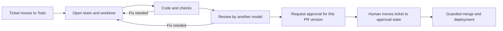

# Cleared

**Your agents do the work. Nothing ships until it's cleared.**

Cleared uses scripts to take a Linear ticket through a coding team, checks, an independent model review, human approval, and a guarded merge. It keeps each team's work in a Git worktree and records actions, costs, and decisions in a SQLite ledger.



This diagram shows the normal path for an application change. The configured tooling exception is described below.

## Principles

- Scripts coordinate the workflow; a model does not decide when to merge.
- Application changes require a human to approve the version shown to them. Paths explicitly configured as `tooling_paths` can merge after review and green checks without a ticket approval; audit that list before using unattended shipping.
- The reviewer cannot be the model that wrote the change.
- Cleared runs on your CLI subscriptions and your Linux host. It does not resell model calls.
- The ledger records runs, costs, events, and decisions so the process can be inspected.

## Status

**Alpha, Linux only.** Cleared has run on one production project since October 2026. Worktrees, model routing, cross-model review, approval checks, the ledger, and a static dashboard are exercised by the test suite. Setup still assumes a GitHub repository, Linear, a Node-oriented project, and project-specific rules. Automatic terminals currently require Orca; other ticket trackers, OpenCode, and a terminal without Orca are future work. Tooling-only changes are exempt from the ticket approval check when configured that way. CLI permissions and the private-term guard are safeguards, not an operating-system sandbox.

## Requirements

Linux with systemd, Node.js 24, git, jq, GitHub CLI (`gh`), a Linear account and API credentials, and Claude Code and/or Codex CLI. Authenticate the CLIs before starting. Orca is optional for reading configuration and running scripts, but **required today for automatic team terminals**. Tailscale is required only if you install the dashboard and wake timers. A separate Linear application identity is needed before allowing unattended shipping; see [Security](docs/security.md).

## Open a test team

Use a disposable GitHub project with a `main` branch and a test ticket such as `EX-1` already in your Linear team's **Todo** state. Copy both clone URLs from the repositories' **Code → HTTPS** menus. The commands below assume the required CLIs are installed and authenticated. Run them in a new parent directory, not in a checkout serving an existing project.

```sh
git clone '<cleared-repository-url>' cleared
git clone '<your-test-project-git-url>' sample-app
cd sample-app
mkdir -p .cleared && cp ../cleared/agents.example.conf .cleared/agents.conf
od -An -tx1 -N32 /dev/urandom | tr -d ' \n'
${EDITOR:-vi} .cleared/agents.conf
git add .cleared/agents.conf && git -c user.name='Test User' -c user.email='test@example.invalid' commit -m "chore: configure Cleared"
git push origin main
CLEARED_REPO=$PWD ../cleared/spawn-lane.sh dev EX-1 --dry-run
CLEARED_REPO=$PWD ../cleared/spawn-lane.sh dev EX-1
```

In the editor, set `[guard] salt` to the random value printed above and set `terms = none` and `allowed = none` **only for a test repository without private terms**. Replace the example Linear team and states, worktree root, model IDs, and adapter settings with values available on your machine. Set `LINEAR_API_KEY` or the separate `LINEAR_APP_CLIENT_ID` and `LINEAR_APP_CLIENT_SECRET` in the environment or an untracked `.env.local`. The final command opens a worktree and Orca terminal; the ticket's team then starts. If Orca cannot open the terminal, Cleared prints the exact command to run in the created worktree. Do not use the example's model IDs or salt as production settings.

## Read more

- [Concepts and ticket lifecycle](docs/concepts.md)
- [Configuration reference](docs/configuration.md)
- [Model adapters](docs/adapters.md)
- [Security boundaries](docs/security.md)
- [Roadmap](docs/roadmap.md)
- [Contributing](CONTRIBUTING.md) · [Report a vulnerability privately](SECURITY.md)
