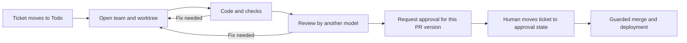

# Cleared

**Your agents do the work. Nothing ships until it's cleared.**

Cleared is for developers who want coding agents to work on tickets while keeping review and shipping decisions visible. Scripts take a ticket through a coding team, checks, an independent review, human approval, and a guarded merge; Git worktrees isolate the work, and a SQLite ledger records actions, costs, and decisions.

A local release broker checks tracker approval and the reviewed PR before merging; agent harnesses only request release over its Unix socket. Optional release health checks can watch the application after Cleared merges a PR. Repeated failures can trigger a revert of that exact merge, and a verified human owner can request the same revert with `cleared rollback TICKET`. Cleared pushes the revert to the base branch so the project's own deployment platform can redeploy it. See [Release configuration](docs/configuration.md#release) for the required health probe, branch permissions and migration limits.

`cleared status` shows the last wake, service reachability and stalled work without starting a model. An optional push heartbeat lets an external service alert you when Cleared stops waking or gets stuck. See [Heartbeat and status](docs/heartbeat.md).

To let an agent search the v2 session history read only, with secrets removed, give it this line: `claude mcp add cleared-ledger -e CLEARED_STATE_DIR=<folder of ledger.db> -- node <cleared checkout>/v2/src/cli/ledger-mcp.ts` (see [the ledger's MCP server](v2/README.md#the-ledgers-mcp-server)).

When something waits for the human (a release to agree to, a team's question) or goes wrong (a rollback, a health problem, a team blocked), the wake tells him on his phone: through the app installed on the Home Screen (Web Push, no outside account), or ntfy, Telegram or e-mail. See [Notifications](docs/notifications.md).



This diagram shows the normal path for an application change. The configured tooling exception is described below.

## Principles

- Scripts coordinate the workflow; a model does not decide when to merge.
- Application changes require a human to approve the version shown to them. Paths explicitly configured as `tooling_paths` can merge after review and green checks without a ticket approval; audit that list before using unattended shipping.
- Today, review requires a different model from the one that wrote the change. A fresh session on the same subscription, without the author's context, is planned for developers who have only one model.
- Cleared runs on your CLI subscriptions and your Linux host. It does not resell model calls.
- Claude Code and Codex coding lanes run on the host under the same configured role policy. Codex can instead use a project-owned container runner. Either host harness can read every file readable by the Cleared account; use a dedicated system account without other projects' secrets if you need stronger isolation.
- The ledger records runs, costs, events, and decisions so the process can be inspected.
- Optional project memory gives a new team a bounded briefing from project files and the previous session's handover. It is off by default; enable it with `[memory] enabled = true` in the project's tracked `.cleared/agents.conf`.

## Status

**Alpha, Linux only.** Cleared was used on one production project in October 2026; that installation is currently disconnected pending a clean reinstall. Worktrees, model routing, cross-model review, approval checks, the ledger, and a static dashboard are exercised by the test suite. Claude Code and Codex CLI are supported today. Cleared aims to support many coding harnesses; OpenCode, Gemini CLI, and Copilot CLI are planned. Setup still assumes a GitHub repository for pull requests, a Node-oriented project, and project-specific rules. Ticket tracking can use Linear, GitHub Issues, or local SQLite. Sessions run in Orca terminals by default. With `[terminal] adapter = none`, they run detached without any terminal, started by the wake's systemd user service. A tmux adapter is planned. The read-only Cleared app (Cockpit) shows the factory live on desktop and phone. Tooling-only changes are exempt from the ticket approval check when configured that way. Claude CLI permissions and the private-term guard are safeguards; Codex also applies an operating-system sandbox to its commands. Neither isolates files readable by the Cleared account.

## Requirements

Linux with systemd, Node.js 24, git, jq, curl, GitHub CLI (`gh`), Claude Code and/or Codex CLI. Forge calls use the `gh` login and git credentials of the service account, or a GitHub App configured in [`[forge]`](docs/configuration.md#forge) so that pull requests, pushes and merges show as its bot with one-hour tokens. Linear credentials are needed only for the Linear tracker; GitHub Issues needs a GitHub App ID, installation ID, and private key so Cleared can renew its installation token, plus Tesseract OCR for capture uploads; local tracking needs separate operating-system accounts and an approval signing key. Authenticate the CLIs before starting (as `[security] agent_user` when it is set): `serve/install.sh` proves each configured model answers, with one small request per model on the subscription, before it installs any service; `serve/check-harness.sh` runs the same check by hand. `serve/install.sh` never binds or publishes ports 80 and 443, nor a port already in use, and checks them before writing anything ([Decisions](docs/concepts.md#decisions)). Orca is needed only with the default `[terminal] adapter = orca`. With `none`, no terminal is needed (see [Configuration](docs/configuration.md#terminal)). Tailscale is required only if you install the dashboard and wake timers. A repository where the base branch can be protected is recommended (a private repository on a free GitHub plan cannot be; see [Security](docs/security.md#branch-protection)). Separate agent and human identities are needed before allowing unattended shipping; see [Ticket trackers](docs/trackers.md) and [Security](docs/security.md).

## Open a test team

This example uses Linear. For GitHub Issues or local SQLite, follow [Ticket trackers](docs/trackers.md) to create the test ticket and configure `[tracker]` first. Use a disposable GitHub project with a `main` branch and a test ticket such as `EX-1` already in your Linear team's **Todo** state. Copy both clone URLs from the repositories' **Code → HTTPS** menus. Install and authenticate the required CLIs, then export `LINEAR_API_KEY` or the separate `LINEAR_APP_CLIENT_ID` and `LINEAR_APP_CLIENT_SECRET` before running the commands: the dry run queries Linear. Run the commands in a new parent directory, not in a checkout serving an existing project.

```sh
git clone '<cleared-repository-url>' cleared
git clone '<your-test-project-git-url>' sample-app
cd sample-app
mkdir -p .cleared && cp ../cleared/agents.example.conf .cleared/agents.conf
od -An -tx1 -N32 /dev/urandom | tr -d ' \n'
${EDITOR:-vi} .cleared/agents.conf
git add .cleared/agents.conf && git -c user.name='Test User' -c user.email='test@example.invalid' commit -m "chore: configure Cleared"
git push origin main
CLEARED_REPO=$PWD ../cleared/spawn-lane.sh dev EX-1 --dry-run
CLEARED_REPO=$PWD ../cleared/spawn-lane.sh dev EX-1
```

In the editor, set `[guard] salt` to the random value printed above and set `terms = none` and `allowed = none` **only for a test repository without private terms**. Replace the example tracker team and states, worktree root, model IDs, and adapter settings with values available on your machine. The final command opens a worktree and an Orca terminal (or, with `[terminal] adapter = none`, a detached session); the ticket's team then starts. If the session cannot be started, Cleared prints the exact command to run in the created worktree. Do not use the example's model IDs or salt as production settings.

## Read more

- [Concepts and ticket lifecycle](docs/concepts.md)
- [Heartbeat and status](docs/heartbeat.md)
- [The Cleared app](docs/app.md)
- [Notifications](docs/notifications.md)
- [Memory contract and briefing](docs/memory.md)
- [Configuration reference](docs/configuration.md)
- [Model adapters](docs/adapters.md)
- [Ticket trackers](docs/trackers.md)
- [Security boundaries](docs/security.md)
- [Roadmap](docs/roadmap.md)
- [Contributing](CONTRIBUTING.md) · [Report a vulnerability privately](SECURITY.md)
