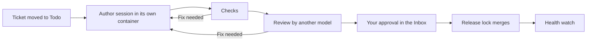

# Cleared

**Your agents do the work. Nothing ships until it's cleared.**

Cleared takes your tickets through coding agents and keeps the decisions with you. A ticket moved to Todo gets its own session: an author writes the change in a container of its own, with no route out but a filtered proxy; a reviewer of another model reads it; the change and its proof wait in your Inbox. Nothing is merged until you approve that exact version. Then a release lock merges it and, when the project declares one, watches its health and can roll it back. A ledger keeps every session, cost and decision.



## How it works

- **One machine, under Docker Compose.** Three containers (the service, the web app and the release lock) and one container per session. Every Docker object Cleared makes carries the label `cleared.dev=v2`, and Cleared acts only on what it lists by that label.
- **Your subscriptions.** Sessions run Claude Code on your Claude subscription. Cleared does not resell model calls.
- **Your forge.** GitHub or GitLab: Cleared pushes a branch per ticket and opens a pull request; your CI runs as usual.
- **Scripts decide the flow, not a model.** A model writes and reviews; when to review, when to ask you and when to merge are code.
- **Nothing ships without you.** The release lock checks your signed approval of the reviewed head before it merges.
- **On this machine only.** The app listens on `127.0.0.1`; from another computer you forward its port over SSH.

## What it needs

- Linux with Docker Engine and its Compose plugin, and git. Nothing else is installed on the machine.
- An account that is not root, in the `docker` group. The `service` container holds the Docker socket, which gives it root's reach on the machine, as the `docker` group does for any account.
- 5 GB free at least, 20 GB to work in comfort.
- Ports 8791, 8792 and 8794 free on `127.0.0.1`.
- A GitHub fine-grained token or a GitLab token for your repositories, and a Claude subscription.

Docker Desktop on macOS or Windows is not supported yet.

## Install

From a clone of this repository, as that account:

```sh
docker compose -f v2/compose.yaml run --rm install
```

The command checks Docker, the ports and the state folder before it writes anything, builds the images on the machine (a few minutes, once), starts Cleared and prints its address with a one-time setup code. Run again, it changes nothing that runs. [docs/install.md](docs/install.md) has the details: the settings, what the command refuses, SSH from another computer, updating, stopping and removing everything.

## The setup assistant

Open the address the command printed and follow the assistant, in English or French. Its eight steps:

1. **Your account**: the setup code, your name and a password.
2. **Forge**: a GitHub or GitLab token, checked on the spot.
3. **Claude Code**: the line `claude setup-token` prints, run in a terminal the page opens.
4. **Repositories**: the ones Cleared works on, with the links between them proposed for you to tick.
5. **Environment**: an image per service with its dependencies, built ahead.
6. **Test secrets**: the values your tests need, encrypted on the machine (or skip).
7. **Checks**: each part of the install green, or red with what to do.
8. **First ticket**: a one-line change, taken through review and your approval to live.

Each step says how long it took, your time and the machine's. Tokens are kept in files of the state folder, never shown again, never sent back to the browser. [docs/install.md](docs/install.md#the-setup-assistant) shows each step.

When a check is red, [docs/troubleshooting.md](docs/troubleshooting.md) says what each line of `cleared doctor` means and what to do.

To start tickets from a terminal or a script, without the app: [docs/run.md](docs/run.md) (`cleared run` and the API).

## Status

**Alpha, Linux only.** Cleared v2 is built on the `v2` branch, milestone by milestone, each requirement with its test in [the requirements matrix](docs/v2/requirements-matrix.md). The one-command install and the assistant are milestone 5; its proof, a developer new to Cleared taking a first ticket to live in under an hour on a fresh machine, has not been run yet. Known gaps of a Compose install are listed in [troubleshooting](docs/troubleshooting.md#known-gaps-of-a-compose-install): the release lock does not get the project from the assistant yet (issue #438). Claude Code is the harness the assistant sets up; the others Cleared can drive are described in [Model adapters](docs/adapters.md).

## Read more

- [Installing Cleared](docs/install.md)
- [Troubleshooting](docs/troubleshooting.md)
- [`cleared run` and the API](docs/run.md)
- [Cleared v2 inside](v2/README.md): the service, the app, the sessions, every setting, the commands for people working on Cleared, and the ledger's MCP server
- [Model adapters](docs/adapters.md)
- [The fast lane](docs/fast-lane.md)
- [The decisions log](docs/v2/decisions-log.md) and [the milestone 5 plan](docs/v2/milestone-5-plan.md)
- [Contributing](CONTRIBUTING.md) · [Report a vulnerability privately](SECURITY.md)

The other pages of `docs/` (concepts, configuration, security, the app, trackers, notifications, heartbeat, memory, roadmap) were written for v1 and are kept until v2 replaces what they describe.
