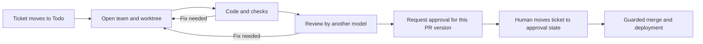

# Cleared

**Your agents do the work. Nothing ships until it's cleared.**

Cleared is for developers who want coding agents to work on tickets while keeping review and shipping decisions visible. Scripts take a ticket through a coding team, checks, an independent review, human approval, and a guarded merge; Git worktrees isolate the work, and a SQLite ledger records actions, costs, and decisions.

Optional release health checks can watch the application after Cleared merges a PR. Repeated failures can trigger a revert of that exact merge, and a verified human owner can request the same revert with `cleared rollback TICKET`. Cleared pushes the revert to the base branch so the project's own deployment platform can redeploy it. See [Release configuration](docs/configuration.md#release) for the required health probe, branch permissions and migration limits.

`cleared status` shows the last wake, service reachability and stalled work without starting a model. An optional push heartbeat lets an external service alert you when Cleared stops waking or gets stuck. See [Heartbeat and status](docs/heartbeat.md).



This diagram shows the normal path for an application change. The configured tooling exception is described below.

## Principles

- Scripts coordinate the workflow; a model does not decide when to merge.
- Application changes require a human to approve the version shown to them. Paths explicitly configured as `tooling_paths` can merge after review and green checks without a ticket approval; audit that list before using unattended shipping.
- Today, review requires a different model from the one that wrote the change. A fresh session on the same subscription, without the author's context, is planned for developers who have only one model.
- Cleared runs on your CLI subscriptions and your Linux host. It does not resell model calls.
- Claude Code and Codex coding lanes run on the host under the same configured role policy. Codex can instead use a project-owned container runner. Either host harness can read every file readable by the Cleared account; use a dedicated system account without other projects' secrets if you need stronger isolation.
- The ledger records runs, costs, events, and decisions so the process can be inspected.
- Optional project memory gives a new team a bounded briefing from project files and the previous session's handover. It is off by default; enable it with `[memory] enabled = true` in the project's tracked `.cleared/agents.conf`.

## Status

**Alpha, Linux only.** Cleared was used on one production project in October 2026; that installation is currently disconnected pending a clean reinstall. Worktrees, model routing, cross-model review, approval checks, the ledger, and a static dashboard are exercised by the test suite. Claude Code and Codex CLI are supported today. Cleared aims to support many coding harnesses; OpenCode, Gemini CLI, and Copilot CLI are planned. Setup still assumes a GitHub repository for pull requests, a Node-oriented project, and project-specific rules. Ticket tracking can use Linear, GitHub Issues, or local SQLite. Automatic terminals currently require Orca. A terminal adapter for Orca, tmux, or no terminal is planned so Cleared can also run without a graphical terminal. The read-only Cleared app (Cockpit) shows the factory live on desktop and phone. Tooling-only changes are exempt from the ticket approval check when configured that way. Claude CLI permissions and the private-term guard are safeguards; Codex also applies an operating-system sandbox to its commands. Neither isolates files readable by the Cleared account.

## Requirements

Linux with systemd, Node.js 24, git, jq, curl, GitHub CLI (`gh`), Claude Code and/or Codex CLI. Linear credentials are needed only for the Linear tracker; GitHub Issues needs a GitHub App ID, installation ID, and private key so Cleared can renew its installation token, plus Tesseract OCR for capture uploads; local tracking needs separate operating-system accounts and an approval signing key. Authenticate the CLIs before starting. Orca is optional for reading configuration and running scripts, but **required today for automatic team terminals**. Tailscale is required only if you install the dashboard and wake timers. Separate agent and human identities are needed before allowing unattended shipping; see [Ticket trackers](docs/trackers.md) and [Security](docs/security.md).

## Open a test team

This example uses Linear. For GitHub Issues or local SQLite, follow [Ticket trackers](docs/trackers.md) to create the test ticket and configure `[tracker]` first. Use a disposable GitHub project with a `main` branch and a test ticket such as `EX-1` already in your Linear team's **Todo** state. Copy both clone URLs from the repositories' **Code → HTTPS** menus. Install and authenticate the required CLIs, then export `LINEAR_API_KEY` or the separate `LINEAR_APP_CLIENT_ID` and `LINEAR_APP_CLIENT_SECRET` before running the commands: the dry run queries Linear. Run the commands in a new parent directory, not in a checkout serving an existing project.

```sh
git clone '<cleared-repository-url>' cleared
git clone '<your-test-project-git-url>' sample-app
cd sample-app
mkdir -p .cleared && cp ../cleared/agents.example.conf .cleared/agents.conf
od -An -tx1 -N32 /dev/urandom | tr -d ' \n'
${EDITOR:-vi} .cleared/agents.conf
git add .cleared/agents.conf && git -c user.name='Test User' -c user.email='test@example.invalid' commit -m "chore: configure Cleared"
git push origin main
CLEARED_REPO=$PWD ../cleared/spawn-lane.sh dev EX-1 --dry-run
CLEARED_REPO=$PWD ../cleared/spawn-lane.sh dev EX-1
```

In the editor, set `[guard] salt` to the random value printed above and set `terms = none` and `allowed = none` **only for a test repository without private terms**. Replace the example tracker team and states, worktree root, model IDs, and adapter settings with values available on your machine. The final command opens a worktree and Orca terminal; the ticket's team then starts. If Orca cannot open the terminal, Cleared prints the exact command to run in the created worktree. Do not use the example's model IDs or salt as production settings.

## Read more

- [Concepts and ticket lifecycle](docs/concepts.md)
- [Heartbeat and status](docs/heartbeat.md)
- [The Cleared app](docs/app.md)
- [Memory contract and briefing](docs/memory.md)
- [Configuration reference](docs/configuration.md)
- [Model adapters](docs/adapters.md)
- [Ticket trackers](docs/trackers.md)
- [Security boundaries](docs/security.md)
- [Roadmap](docs/roadmap.md)
- [Contributing](CONTRIBUTING.md) · [Report a vulnerability privately](SECURITY.md)
