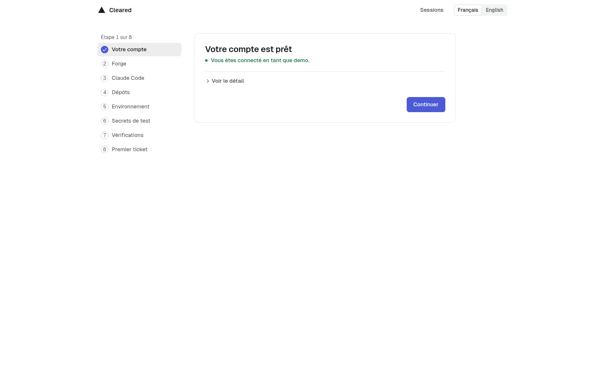
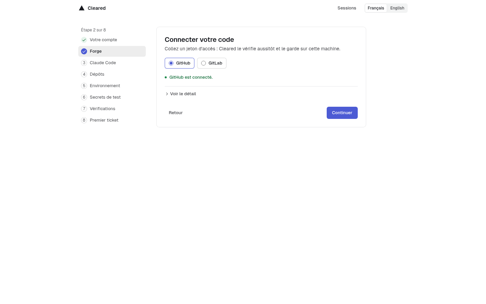
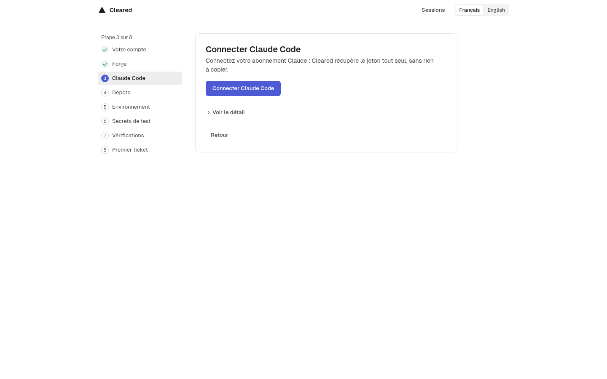
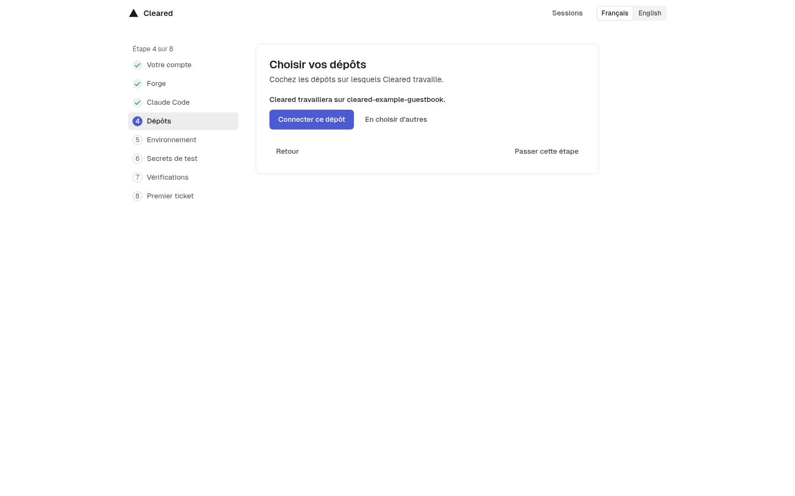
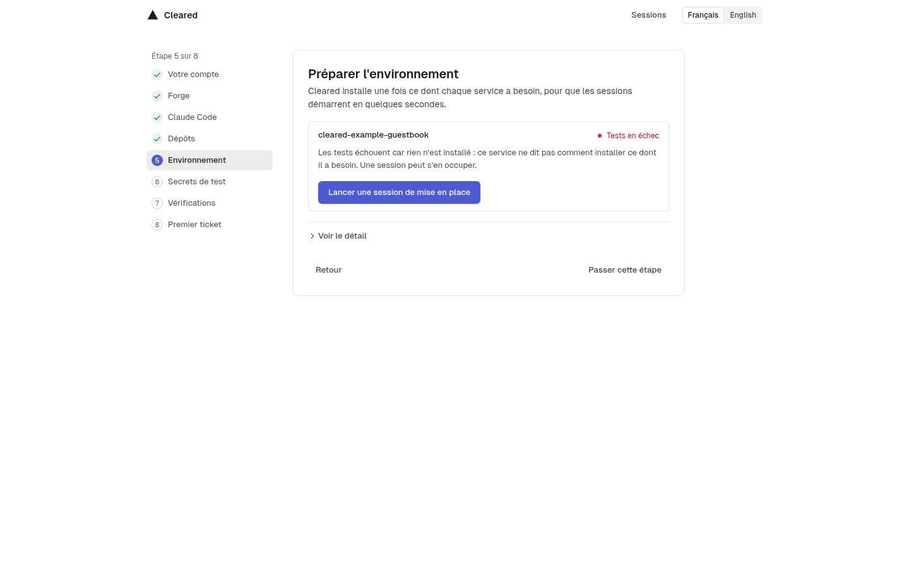
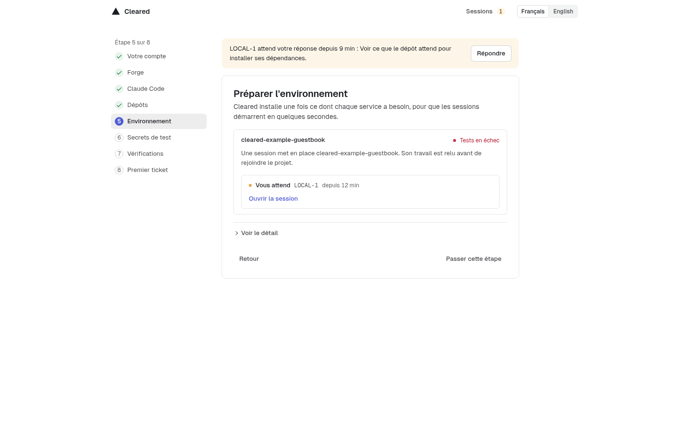
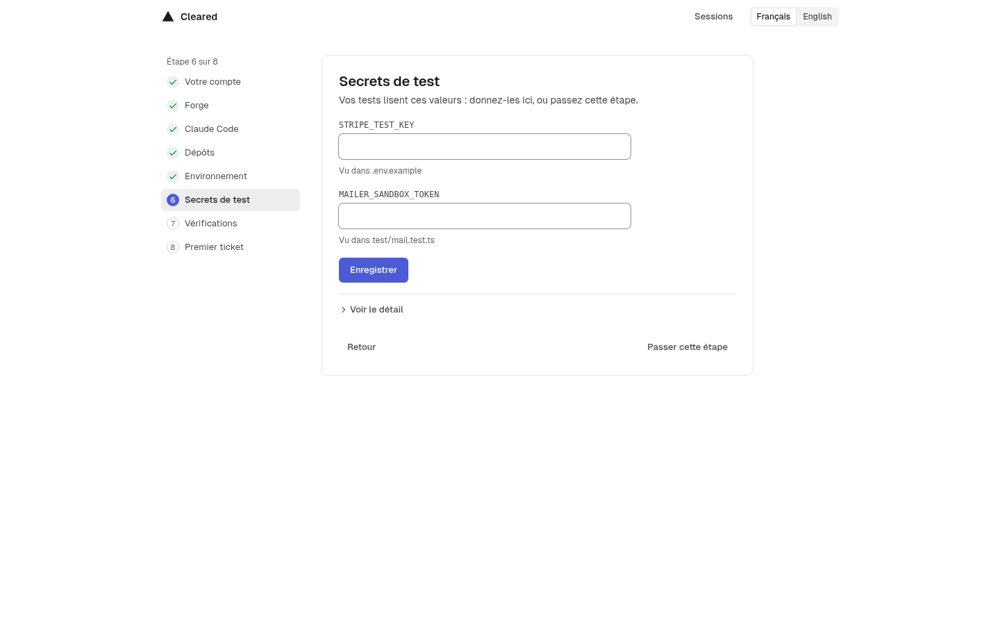
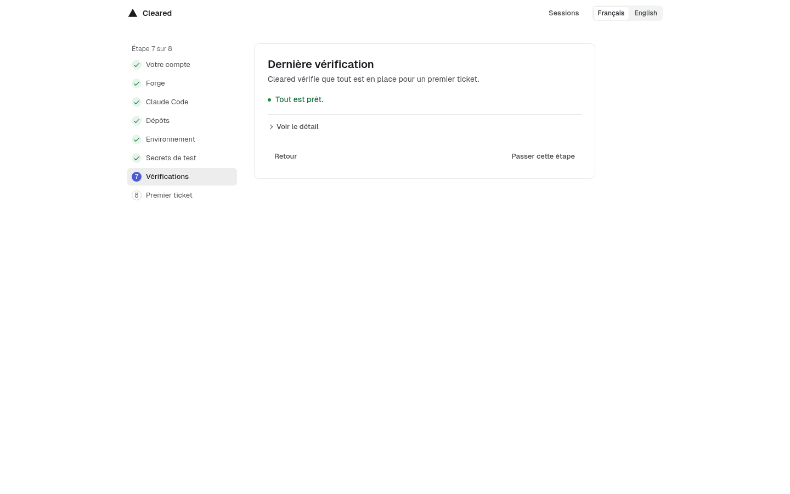
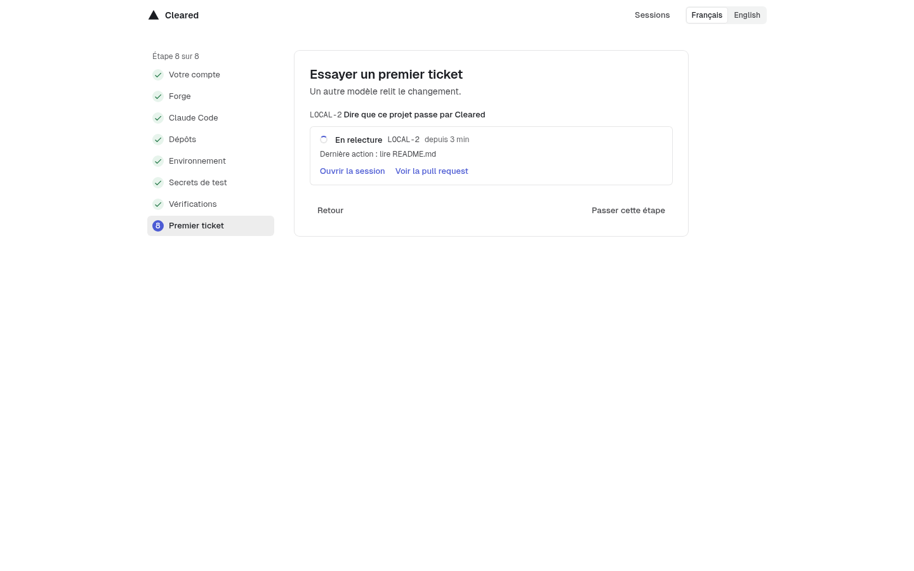

# Installing Cleared

Cleared runs on one Linux machine, under Docker Compose. One command starts it; a setup assistant in the browser does the rest: your account, the forge, the Claude Code login, the repositories, their environment, the checks and a first ticket. After the command, nothing is typed on the machine and no file is edited by hand.

## What it needs

- **Linux with Docker Engine** and its Compose plugin, and **git**. Nothing else is installed on the machine: the command runs in Cleared's own image, which it builds from the clone. Docker Desktop on macOS or Windows is not supported yet: the sessions are given paths of the host and rely on Docker Engine's networks.
- **An account that is not root**, in the `docker` group, that owns the clone. Cleared's containers and every session run as that account.
- **Disk:** 5 GB free at least on the state folder's disk, 20 GB to work in comfort. The session image alone takes several gigabytes.
- **Three free ports on `127.0.0.1`:** 8791 (the service), 8792 (the app) and 8794 (the Browser tab's previews). Cleared never binds 80, 443, 8787, 8788 or 8790, and refuses a port another program holds.
- **A forge account:** a GitHub fine-grained token, or a GitLab personal access token with the `api` scope, for the repositories Cleared works on.
- **A Claude subscription.** Sessions run Claude Code with the login `claude setup-token` prints. An Anthropic API key is not taken.

The `service` container holds the Docker socket, which gives it root's reach on the machine, as membership of the `docker` group gives any account. Install Cleared on a machine where that is acceptable.

## The one command

As the account that will own Cleared, in a folder of that account:

```sh
git clone <this repository's address> cleared
cd cleared
docker compose -f v2/compose.yaml run --rm install
```

The first run builds Cleared's image, then the session and egress images: several minutes, once per machine. The command ([`v2/src/cli/install.ts`](../v2/src/cli/install.ts), with [`v2/compose.yaml`](../v2/compose.yaml)):

1. refuses a reserved port, a port named twice, or a state folder that is not an absolute path, before it asks Docker anything;
2. checks that Docker and Compose answer;
3. when Cleared already runs, changes nothing and says the address;
4. refuses a clone that belongs to root, and a port something else holds, before it writes anything;
5. makes the state folder for the clone's owner, mode 700;
6. builds the missing images, starts the service, the app and the release lock, waits for the app's first answer, and says the address and the setup code.

It ends with lines like these (the address, the time and the code are yours):

```text
Cleared answers on http://127.0.0.1:8792/ (answered in 12 s).
Open that address in a browser on this machine. From another computer, forward the port over SSH first: ssh -L 8792:127.0.0.1:8792 <this machine>
The service says: cleared-v2: setup code ABCD-EFGH, valid until <date>: open the app's address at /setup and type it to create the owner's account
```

Keep the setup code for the assistant's first step. It works once, within 24 hours; a restart of the service prints a new one.

The settings are environment variables, read each time a Compose command runs. Give the same ones to every later command (`down`, `restart`, the doctor), for example by exporting them in your shell:

| Variable | Default | What it sets |
| --- | --- | --- |
| `CLEARED_V2_STATE_DIR` | `/var/lib/cleared-v2` | The state folder: the ledger, the keys, the tokens, each ticket's checkout. |
| `CLEARED_V2_PORT` | `8791` | The service, on `127.0.0.1`. |
| `CLEARED_V2_APP_PORT` | `8792` | The app, on `127.0.0.1`. |
| `CLEARED_V2_PREVIEW_PORT` | `8794` | The Browser tab's previews, on `127.0.0.1`. |
| `CLEARED_V2_APP_LANGUAGE` | `fr` | `en` or `fr`, for the command's words and the app's default. |
| `COMPOSE_PROJECT_NAME` | `cleared-v2` | A second install on one machine, with its own state folder and ports. |

For example, in English with the state folder in your home:

```sh
export CLEARED_V2_APP_LANGUAGE=en CLEARED_V2_STATE_DIR="$HOME/cleared-state"
docker compose -f v2/compose.yaml run --rm install
```

### When the command stops

A refusal ends with "Nothing was written.": the command stopped before writing or starting anything. Run it again once the cause is fixed. The last line of the table is different: Cleared was started and did not answer in time.

| The command says | What to do |
| --- | --- |
| `{name} is {port}: Cleared never binds {reserved}. Choose another port.` | Set that variable to another port. |
| `{name} is {port}, and {address}:{port} is already in use on this machine.` | Stop the program that holds it (`ss -ltnp` names it), or set the variable to a free port. |
| `Docker does not answer here: {reason}.` | Install Docker Engine, add the account to the `docker` group, open a new session. |
| `Docker Compose does not answer: {reason}.` | Install Docker's Compose plugin (`docker compose version` answers once it is there). |
| `The clone belongs to root, and Cleared would run its sessions as root.` | Clone the repository again as your own account, and run the command from there. |
| `The state folder {path} belongs to uid {uid}, not to the owner of the clone (uid {owner}).` | Pick another `CLEARED_V2_STATE_DIR`, or give that folder to the clone's owner. |
| `Other accounts may write in the state folder {path} (mode {mode}).` | Run `chmod go-w` on it. |
| `Cleared does not answer on {address} after {duration}.` | Read what Cleared says with the `docker compose ... logs app service` line it prints. |

## The setup assistant

Open the address the command printed, on the same machine (or [from another computer](#from-another-computer)). Every page sends you to `/setup` until the owner's account exists. Each step is one sentence and one action, with the rest behind Show details; the list on the left shows where you are. Back returns to a step; Skip leaves a step that allows it for later. Sessions and the language choice are at the top right, and a session waiting for your answer is said on every step, with a link to answer. The captures below use the app's fixtures and made-up answers.

### 1. Your account

Type the setup code the command printed, a name and a password of 15 characters at least. The account is the owner's: it approves releases. Cleared also makes its approval signature on this machine; there is nothing to add to your repository.



### 2. Your code

Pick GitHub or GitLab and paste a token. Cleared checks it with the forge at once and keeps it in a file of the state folder that no other account can read. The page never shows the token again; since when one is saved and Replace are in the details.

For GitHub, the page links to the fine-grained token form with the name and the required permissions filled in: Metadata (read), Contents and Pull requests (read and write), Commit statuses (read). Add Workflows only if a ticket may change `.github/workflows/`, Issues only for the GitHub Issues mirror. For GitLab: the `api` scope, and the Developer role on each project (Maintainer to merge into a protected branch).



### 3. Claude Code

Connect Claude Code opens a terminal running `claude setup-token`, in a throwaway container with nothing of this machine in it. Open the link it shows, sign in with your Claude account and paste the code back in the terminal. Cleared takes the token from the output itself, masks it, saves it, and removes the container. The terminal opens on the app's loopback address only: elsewhere, or if you prefer, run the command on any computer with Claude Code and paste what it prints, under Show details. Spaces and line breaks in a wrapped token do not matter.



### 4. Repositories

The repositories the token reaches are listed; tick the ones Cleared works on. Cleared clones and reads them. One repository with one service, no contract and no call is said in one sentence. Otherwise it proposes the services, the folders of a monorepo, their contracts and the calls between them, each with the file and line that suggested it, and only the lines you tick are written. The list comes from GitHub only for now: the step does not list GitLab projects yet (issue #424).



### 5. Environment

Each service gets an image built ahead, with its dependencies installed, so that a session starts on it in seconds. The image comes from the project's `.devcontainer`, else Cleared's own session image. The step shows each service's state, then runs the project's declared check in the image. When tests fail, it says why in one sentence and offers a setup session: a ticket whose author writes the `.devcontainer`, reviewed and approved like any other. The session then shows live on the step, with a link to it. Commands, images and the tests' last lines are in the details.





### 6. Test secrets

The step reads the base branch of your repositories (example environment files, what the tests read from the environment, what the workflows take from their secrets) and asks for the names that look like secrets, one field each. The values are encrypted on this machine, given to the sessions and the tests only, removed from everything Cleared writes, and never shown again. With none to ask for, it says so and skips itself; any other value can be added under Show details.



### 7. Checks

The checks of `cleared doctor`: Docker, the images, the state folder, the disk, the settings, the tokens, the repositories and their checkouts. The step says "Everything is ready", or each thing to fix in one sentence, with its button when another step fixes it. Every line is in the details; [troubleshooting.md](troubleshooting.md) explains each one.



### 8. First ticket

A small first ticket, for one of your repositories: one line added at the end of its README, its text in the details. One button starts it. The step then says where it stands and shows its session live, with links to the session and the pull request. Its plan waits for your Go in Reception and its release for your approval; the step links to each. Once it is live, the time of each step is in a fold.



On a Compose install, the release lock still reads the owner's public key from the project's `.cleared/agents.conf` only, so the approved first ticket is not merged there until that line is in the repository. [Troubleshooting](troubleshooting.md#known-gaps-of-a-compose-install) lists this gap and the others.

Once every step is done or skipped, Open Cleared leads to the app. A skipped step stays in `/setup` for later.

## From another computer

Cleared listens on `127.0.0.1` only and publishes nothing. From another computer, forward the ports over SSH, then open `http://127.0.0.1:8792` there:

```sh
ssh -L 8792:127.0.0.1:8792 -L 8794:127.0.0.1:8794 <you>@<this machine>
```

The second forward is for the Browser tab's previews, which the browser loads from their own port; the app works without it. With other ports set at install, forward those. Cleared opens no tunnel and serves nothing to a network.

## What needs a restart

The workspace the Repositories step writes is used at once, with no restart: the first ticket, the tickets and batches typed in the Tower, the lead with its plans, schedules and service map, the quota reading, the lessons proposed from handovers, the notifications, the tracker mirrors, `cleared run` and the workspace's record all start on it. The checks, the test secrets and the environment step read it at each use.

The address and the trial a service's receipt captures need, confirmed on the environment step, are used from the next ticket on, with no restart either. The step proposes them from the repository (its `[release] health_url` and the first `EXPOSE` of its Dockerfile) and writes nothing until you confirm. The image holds Playwright's Chromium and its ffmpeg, so these captures need nothing else installed.

A restart of the service is needed for:

- A workspace changed once Cleared runs on one: a repository connected later from the Services screen, or one removed. The environment step says so for a new repository, and proposes no setup session for it until the restart.
- The heartbeat's quota line, when the service started before any repository was connected.
- The release trains of a workspace of several repositories. They also need a release lock per repository, each with its own state folder, which the Compose file does not run yet: until then the service's log says the trains' approvals are refused.
- The service's own settings: its port, and what the flow is built with (the models, the idle limit, the review rounds, the budget).

```sh
docker compose -f v2/compose.yaml restart service
```

The restart stops the sessions that run, then puts their tickets back in Todo.

## Updating

From the clone, with the variables the install was given:

```sh
docker compose -f v2/compose.yaml down
git pull
docker compose -f v2/compose.yaml run --rm --build install
```

`down` stops Cleared and keeps the state folder; `--build` builds Cleared's image again from the pulled clone; the install then builds any session image whose version changed and starts Cleared on the new image. Running the install alone while Cleared runs changes nothing, which is why `down` comes first. This path follows from the command's steps and has not been run on a real install yet. `down` stops the service while sessions may be running: update when no ticket is being worked on.

## Stopping

```sh
docker compose -f v2/compose.yaml down
```

The service, the app and the release lock stop and their containers are removed. The state folder stays, and the next `docker compose -f v2/compose.yaml run --rm install` starts Cleared again on it, with no new setup.

## Removing everything

Every Docker object Cleared makes carries the label `cleared.dev=v2`: its containers, its sessions' networks and volumes, and its images. Stop Cleared, then remove them by that label:

```sh
docker compose -f v2/compose.yaml down
docker rm -f $(docker ps -a -q --filter label=cleared.dev=v2)
docker network rm $(docker network ls -q --filter label=cleared.dev=v2)
docker volume rm $(docker volume ls -q --filter label=cleared.dev=v2)
docker image rm $(docker image ls -q --filter label=cleared.dev=v2)
```

Run each list on its own first (`docker ps -a --filter label=cleared.dev=v2`, and so on) to see what it names. The label is the same for every install on the machine: with a second install under another `COMPOSE_PROJECT_NAME`, these commands remove both. The base image `node:24`, pulled from Docker Hub, carries no label and stays.

The state folder is removed by hand, last: `rm -rf` of the folder `CLEARED_V2_STATE_DIR` names (`/var/lib/cleared-v2` by default). It holds the ledger (every ticket, session and approval), the approval signature, the saved tokens and the test secrets' key. Nothing brings it back. Revoke the forge token on GitHub or GitLab too.

## Read more

- [Troubleshooting](troubleshooting.md): each line of `cleared doctor` that is not green, and what to do.
- [`cleared run` and the API](run.md): start a ticket from a terminal or a script.
- [`v2/README.md`](../v2/README.md): how Cleared works inside, every setting, and the commands for people working on it.
