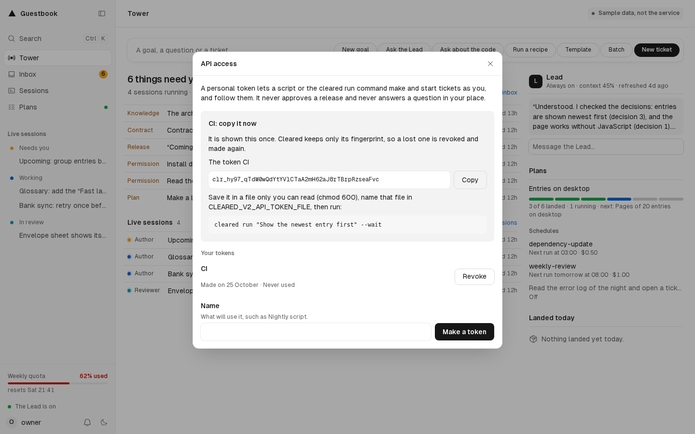

# `cleared run` and the API

A ticket can be made and started without the app: from a terminal with `cleared run`, or from a script with two HTTP routes of the service. Either way the ticket goes through the same path as one made in the app: an author, a reviewer, then a person's approval in the app's Inbox. Neither the command nor the API approves anything.

## A personal API token

Both use a person's API token. Make one in the app: your menu, API access, then a name for what will use it (such as "Nightly script") and Make a token. The value starts with `clr_` and is shown once: copy it then. The service keeps only its SHA-256, the day it was made and its last use. A person holds 20 live tokens at most, and revokes their own from the same panel; a revoked token stops working at once.



A token creates, starts and reads tickets as its person. It never approves a release, never answers a session's question or permission, and never reaches the setup or the settings: only the two run routes below accept it.

Keep it in a file only you can read:

```sh
umask 077
printf '%s\n' 'clr_...' > ~/.cleared-token     # paste the value in place of clr_...
```

Then set `CLEARED_V2_API_TOKEN_FILE` to that file's path (`~/.cleared-token` here) in the shell or the script that runs the command.

`cleared run` refuses a file other accounts can read. The variable `CLEARED_V2_API_TOKEN` can hold the value instead, for a script whose environment is already private. The command never takes the token as an argument, which `ps` and the shell's history would show, and never prints it.

## `cleared run`

```text
cleared run "<task>" [--service <name>] [--template <template>] [--wait]
```

| Part | What it does |
| --- | --- |
| `"<task>"` | The task, in quotes. Its first line is the ticket's title (cut at a word past 200 characters); when the task says more, the whole of it is the description. |
| `--service <name>` | The service of the workspace the ticket is for. Without it, the ticket names no service. |
| `--template <template>` | A ticket template, which gives the ticket its type: `bug`, `review`, `ci`, `question` or `environment`. |
| `--wait` | Follows the ticket and prints each step once, then stops at its approval. |
| `--help` | Prints the usage. |

It calls the service on this machine, at `CLEARED_V2_HOST` and `CLEARED_V2_PORT` (`127.0.0.1:8791` by default), and prints the ticket and its address in the app:

```text
$ cleared run "Fix the date format on the invoice page" --service web --wait
Ticket LOCAL-42 made: Fix the date format on the invoice page.
http://127.0.0.1:8792/
LOCAL-42 has started: http://127.0.0.1:8792/sessions/<session>
Pull request #17 of LOCAL-42: https://github.com/<owner>/<repository>/pull/17
LOCAL-42 waits for your approval in the app's Inbox. Time taken: 18 min.
```

The ticket id, addresses and times above are an example; the second line is the Tower until the ticket has a session. Without `--wait`, the command stops after the first two lines. With it, the command reads the ticket every 5 seconds and says, once each: what holds it in line (a lane, or the quota's stop), its session, its pull request, and where it ended. It ends at the approval, which stays yours, in the app; a ticket already approved or live when it looks ends there too, with the time taken.

The words are English or French, from `CLEARED_V2_APP_LANGUAGE` (French by default). The code is [`v2/src/cli/run.ts`](../v2/src/cli/run.ts).

### Where to run it

- **From a clone with Node.js 24**, on the machine where Cleared runs: `node v2/src/cli/cleared.ts run "<task>"`. In `v2/`, `npm run run -- "<task>"` is the same command.
- **On a Compose install with no Node.js on the machine**, in Cleared's image: `docker compose -f v2/compose.yaml run --rm --no-deps -e CLEARED_V2_API_TOKEN_FILE service cleared run "<task>"`, with the variables the install was given. The container sees no folder of the machine but the state folder, so the token's file must be under it. This form follows from the image's `cleared` role and has not been run yet.
- **From another computer**, forward the service's port over SSH (`ssh -L 8791:127.0.0.1:8791 <you>@<that machine>`) and call the API below. The service listens on `127.0.0.1` only.

### Exit codes

| Code | When |
| --- | --- |
| 0 | The ticket was made. With `--wait`: it waits for its approval, or is past it. |
| 1 | The service refused the ticket (a service that is not in the workspace, for example), or with `--wait`, the ticket went back to Todo or could not start. |
| 64 | A usage error, or a token file that cannot be read, is empty, or is readable by others. |
| 69 | The service does not answer, or cannot run tickets yet (the setup is not finished). |
| 77 | The service refused the token: revoked, of another install, or of a person it no longer has. |

## The API

Two routes of the service, on `127.0.0.1:8791` by default. They take a person's API token as `authorization: Bearer <token>` and no other credential; no other route takes an API token. The shapes are in [`v2/src/run/types.ts`](../v2/src/run/types.ts).

### `POST /api/run`

Makes a ticket and starts it as the token's person. The body is JSON:

| Field | Required | What it is |
| --- | --- | --- |
| `title` | yes | The ticket's title, 1 to 200 characters. |
| `description` | no | Its body, 20,000 characters at most. |
| `service` | no | A service of the workspace; without it, the ticket names none. |
| `template` | no | One of `bug`, `review`, `ci`, `question`, `environment`. |

Any other field is refused. The ticket carries the label `run`, and the template's type label when one is given.

```sh
curl -s http://127.0.0.1:8791/api/run \
  -H "authorization: Bearer $(cat ~/.cleared-token)" \
  -H 'content-type: application/json' \
  -d '{"title": "Fix the date format on the invoice page", "service": "web", "template": "bug"}'
```

The answer is the run, as `GET` gives it.

### `GET /api/run/:id`

Where a ticket made by `POST /api/run` is. `:id` is the ticket's id from the first answer. The answer:

| Field | What it is |
| --- | --- |
| `ticket`, `title` | The ticket's id and title. |
| `status` | The ticket's status in the tracker, as the board shows it. |
| `state` | Where the run is, below. |
| `hold` | While `queued`: what holds it, a lane (`running` of `lanes`) or the quota's window (`percent` of `stop`). Else `null`. |
| `note` | Why, for `put_back` and `failed`. Else `null`. |
| `address` | The ticket's page in the app: its session, else the Tower. `null` when the app's address is not known. |
| `session` | Its session's id, once it has one. |
| `pullRequest` | `{ number, url }`, once it has one. |
| `createdAt`, `startedAt`, `approvalAt`, `liveAt` | When it was made, started, put up for approval and went live (ISO 8601), or `null`. |

The states:

| `state` | Meaning |
| --- | --- |
| `queued` | It waits for a free lane or below the quota's stop; `hold` says which. |
| `starting` | Started; its session is not open yet. |
| `working` | Its author or its reviewer works on it. |
| `approval` | Its pull request waits for a person's approval in the app. |
| `approved` | Approved, being merged. |
| `live` | Merged, and healthy through the release watch when the service declares one. |
| `put_back` | The flow put it back in Todo; `note` says why. |
| `failed` | It could not start; `note` says why. |

### Errors

An error answers `{ "error": "<why>" }`:

| Status | When |
| --- | --- |
| 400 | The body is not JSON, has a field it does not know, or a value out of bounds. |
| 401 | No token, or one that is not live; the answer carries `www-authenticate: Bearer`. |
| 403 | The token's person is no longer a person of this service. |
| 404 | `GET`: no run of that ticket. |
| 409 | The ticket store refused the ticket. |
| 503 | The service cannot run tickets yet: no ledger, or no workspace until the setup is finished. |

A run made through the API polls like `cleared run --wait` does: every few seconds is enough, since a ticket's steps take minutes.
